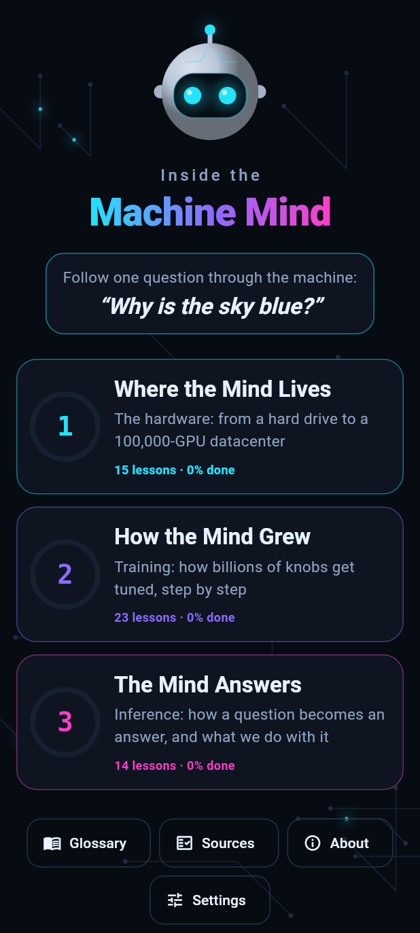
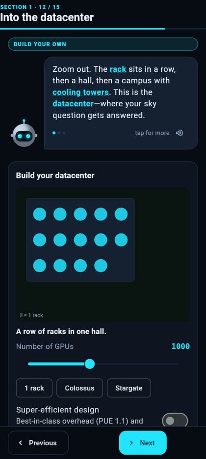
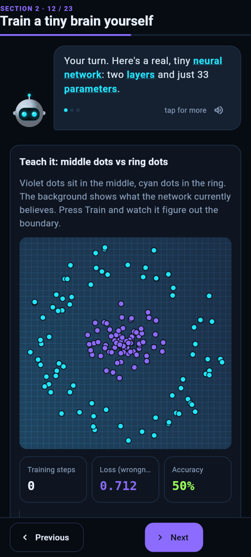
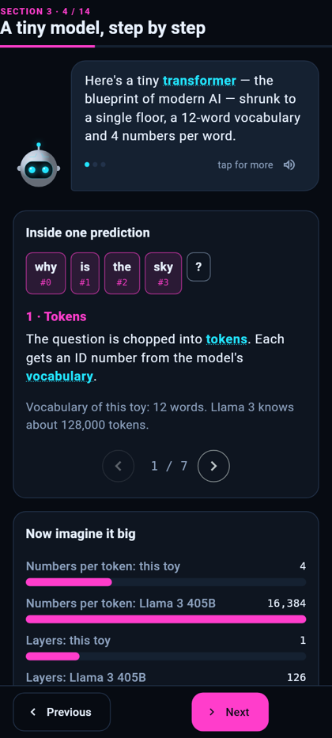

# Inside the Machine Mind

**An interactive Android app that takes you on a journey through how large language models (LLMs) are built: the hardware they live on, how they're trained, and how they answer.**

Your guide is **Bit**, a small robot, and you follow one question all the way through the machine: *"Why is the sky blue?"*

<p align="center">
  
  
  
  
</p>

**Two apps in one (v2):** a friendly **front door** for everyone, and an **Enthusiast Lab** for people who run models themselves. On first launch Bit asks "How much do you already know about AI?", and you can switch any time.

## The front door

| Track | What you'll do |
|---|---|
| **The short journey** | "Why is the sky blue?" through the machine in 17 lessons: chips, datacenters, training, tokens, the answer. |
| **AI in your life** | Spot the made-up fact, ask better, see where your words go (privacy settings of the big apps, from their own help pages), catch voice-clone and deepfake scams, use AI honestly at school and work, pick the right kind of assistant, and find out what runs on your own computer. |

## The Enthusiast Lab

| Track | What's inside |
|---|---|
| **Foundations** | The original journey with the real terms. **Where the Mind Lives** (hardware) covers drives, memory, CPU vs GPU and a datacenter you build yourself. **How the Mind Grew** (training) covers tokenizers, training a tiny network on your phone, loss landscapes and scaling. **The Mind Answers** (inference) covers a toy transformer with real numbers, sampling and decoding model filenames. |
| **Run it yourself** | The **Will it fit?** calculator (model × quant × context × your machine, using real model shapes) and the engines (llama.cpp, Ollama, LM Studio, vLLM, ExLlamaV3, MLX). Also picking a quant from measured KL divergence, the KV cache, MoE offloading with real llama.cpp flags, speculative decoding, RAG, tools and agents, and an honest home-rig case study. |
| **Customize it** | Prompt vs RAG vs fine-tune, LoRA and QLoRA, chat templates and datasets, model merging (task arithmetic, SLERP, TIES, DARE), and steering (control vectors and abliteration, explained factually). |
| **Read the papers** | How to read a paper, and **33 annotated papers** from word2vec to DeepSeek-R1. Each comes with its one idea, why it mattered, where you meet it today and a 3-question check. |
| **State of the art** | The models, the hardware and the tricks that are current, dated October 2026 and sourced from the makers' own announcements and model cards. Also how to read leaderboards, and the year in a timeline. |
| **Industry map** | Who makes what, jobs around AI, and how to keep up. |

Every engineering term comes with an everyday translation. There are 108 terms in the built-in glossary, with "In your life" and "Lab" filters.

**Facts you can check.** Every number in the app comes from a cited source (spec sheets, papers, official announcements, help pages), checked in October 2026: 175 facts from 142 sources. Tap ⓘ on any fact card, or open *Sources*.

**The source library is a plug-in.** A readable copy of every source, plus the original PDFs (61 MB), is a separate download. That keeps the app small. Tap *Get the library* (in Settings or on any source) once, and it works offline from then on. You can also download `machine-mind-library-2026.10.zip` from the [library release](https://github.com/levoniust/inside-the-machine-mind/releases/tag/library-2026.10) and import it.

**Also inside:** quizzes, progress tracking, light and dark themes, reduce-motion support, "Bit reads aloud" (your phone's own voice), phone and tablet layouts, and five hidden Easter eggs. Settings counts how many you've found. 🥚

## Install

Download the APK from the [latest release](https://github.com/levoniust/inside-the-machine-mind/releases/latest) and open it on your Android phone (Android 7.0+). It installs over v1.x and keeps your progress. No accounts, no tracking. The only time the app uses the internet is when you download the source library.

**Or try it in your browser:** https://levoniust.github.io/inside-the-machine-mind/

## Build it yourself

```bash
flutter pub get
flutter test                    # unit + widget tests (every lesson renders cleanly in dark/light at large text)
flutter build apk --release     # without android/key.properties the release build is signed with the debug key
```
Integration test of the full journey on a device or emulator: `flutter test integration_test/journey_test.dart -d <device>`.

## How this app was made

This app was built as an experiment (and a stress test of a homelab): a team of AI models, mostly running locally, designed, wrote, tested and illustrated it in one long overnight session.

- **Claude (Opus 5.5)** orchestrated: planned, wrote the trickiest screens, fact-checked every number, and reviewed everything.
- **Qwen3.8-Flash-Next** (2× RTX 3090) worked as a coding agent.
- **Mirai, a Qwen3.8-27B model** (RTX 5060 Ti), drafted the script, quizzes and research notes, and coded screens.
- **Qwen-Image 2.1** (RTX 3060) painted the hidden gallery.

Find the secret logbook in the app for the details.

## Credits & licenses

- Code: MIT, see [LICENSE](LICENSE).
- Gallery images: generated with Qwen-Image 2.1 ([Qwen Research License](https://huggingface.co/Qwen), non-commercial).
- Facts: see the in-app Sources page (69 sources).
- Built with [Flutter](https://flutter.dev).
